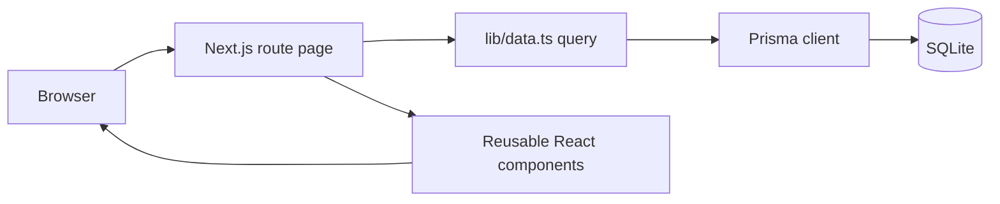
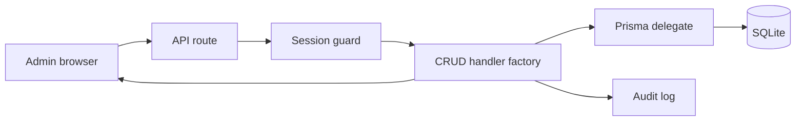

# Design Patterns Used in Kelson Innovations

## Overview

Kelson Innovations is a Next.js application using the App Router, React, TypeScript, Prisma, and SQLite. Its structure combines server-rendered public pages, client-side interactive components, a database-backed content model, and a protected admin dashboard.

The main architectural style is a **layered web application** with **component composition** at the UI level and **shared handler factories** at the API level.

## 1. Layered Architecture

The project separates responsibilities into recognizable layers:

| Layer | Responsibility | Examples |
| --- | --- | --- |
| Presentation | Render pages and reusable interface components | `app/(site)`, `components/`, `app/admin` |
| Application/API | Handle requests, authorization, validation, and workflows | `app/api/`, `middleware.ts` |
| Data access | Query and mutate persistent data | `lib/data.ts`, `lib/prisma.ts` |
| Domain utilities | Encapsulate cross-cutting concerns | `lib/auth.ts`, `lib/audit.ts`, `lib/email.ts`, `lib/rate-limit.ts` |
| Persistence | Define and store application data | `prisma/schema.prisma`, SQLite database |

This separation keeps database queries out of most UI components and keeps reusable security and infrastructure logic out of route handlers.

## 2. Server Components and Client Components

The public site uses Next.js Server Components for pages that primarily fetch and render data. For example, the homepage loads settings, services, testimonials, blog posts, and client logos on the server before composing the page from UI components.

Interactive behavior is isolated in Client Components using the `"use client"` directive. Examples include:

- `CartProvider` for browser-side cart state
- `ResourceManager` for admin CRUD interactions
- Contact, newsletter, checkout, and chatbot interfaces
- Theme and navigation controls

This is a **container/presentation split**:

- Page-level components act as containers that load data and coordinate the screen.
- Smaller components focus on presentation and user interaction.

## 3. Component Composition

The interface is built by composing focused components instead of placing all markup in a single page. The homepage combines components such as `Hero`, `ClientLogos`, `Section`, `ServiceCard`, `StatCounter`, `TestimonialCard`, and `BlogCard`.

This follows the **composition over inheritance** principle. Components receive data through props and can be reused across routes without depending on a specific page implementation.

Example flow:

```text
Home page
  -> loads data
  -> passes settings to Hero
  -> passes clients to ClientLogos
  -> maps services into ServiceCard instances
  -> maps testimonials into TestimonialCard instances
```

## 4. Repository-Style Data Access

`lib/data.ts` acts as a small repository/query layer around Prisma. Functions such as `getServices`, `getBlogPosts`, `getClientLogos`, and `getProductBySlug` provide named application queries rather than exposing Prisma calls throughout the UI.

Benefits:

- Pages do not need to know Prisma query details.
- Ordering and active-record filtering are defined in one place.
- Database access can be changed later without rewriting every page.
- Query intent is clearer at the call site.

`lib/prisma.ts` also implements a shared Prisma client pattern during development so hot reloads do not create an unnecessary number of database clients.

## 5. Factory Pattern for Admin CRUD APIs

`lib/admin-crud.ts` uses a factory-style pattern. Instead of rewriting the same `GET`, `POST`, `PUT`, and `DELETE` logic for every admin resource, the application passes a Prisma delegate to shared handler factories:

```ts
export const { GET, POST } = listCreateHandlers(prisma.clientLogo);
export const { PUT, DELETE } = itemHandlers(prisma.clientLogo);
```

The factories centralize:

- Session checks
- List and item operations
- Request parsing
- Audit-log creation
- Standard response behavior

This reduces duplication and makes new admin-managed resources cheaper to add.

## 6. Provider and Context Pattern for Cart State

`components/CartProvider.tsx` implements the React **Provider pattern** with a Context.

The provider owns cart state and exposes operations such as:

- `addItem`
- `removeItem`
- `updateQuantity`
- `clear`
- `subtotal`
- `count`

Descendant components consume this shared state through `useCart()` instead of passing cart props through every intermediate component.

The cart also uses browser persistence through `localStorage`, allowing the cart to survive page navigation and browser refreshes.

## 7. Middleware and Guard Pattern

Authentication is implemented with a signed JWT stored in an HTTP-only cookie. `lib/auth.ts` owns session creation, verification, and cookie management.

Authorization is applied in two places:

1. `middleware.ts` protects admin routes before they reach the page.
2. `requireSession` in `lib/admin-crud.ts` protects API operations.

This is a **guard pattern** with defense in depth. The user interface is protected, but the API also verifies the session so that a client cannot bypass the dashboard by calling endpoints directly.

## 8. Audit Trail Pattern

Administrative mutations record before-and-after information through `lib/audit.ts` and the `AuditLog` model.

The audit trail captures information such as:

- Acting user
- Action type
- Entity and entity ID
- Previous data
- Updated data
- IP address
- User agent
- Timestamp

This is an **audit trail pattern**: important state changes produce an immutable operational record for accountability and troubleshooting.

## 9. Rate Limiting at the Boundary

Public write endpoints, such as the contact form, use `lib/rate-limit.ts` before processing a request. The endpoint identifies the client, applies a request limit, and returns HTTP `429` with a `Retry-After` header when the limit is exceeded.

This is a **protective boundary pattern**. Abuse prevention happens at the route boundary before expensive work such as database writes or email delivery.

## 10. Validate, Persist, Then Notify

The contact endpoint follows a transactional workflow even though the email notification is external:

1. Parse and normalize the request body.
2. Validate required fields.
3. Persist the contact submission.
4. Attempt email notification.
5. Return a distinct response if persistence succeeds but notification fails.

This ordering preserves the user’s message even when the email service is temporarily unavailable. It also gives the caller a more accurate error message than treating the entire operation as an undifferentiated failure.

## 11. Seed and Upsert Initialization

`prisma/seed.ts` uses conditional creation and upsert-like behavior to initialize site content. Existing records can be updated while missing records are created.

This is an **idempotent initialization pattern**. Running the seed repeatedly should converge the database toward the intended baseline instead of blindly duplicating content.

The pattern is useful for:

- Local development setup
- Demo environments
- Rebuilding a database
- Establishing default CMS content

## 12. Route Groups and Layout Composition

The App Router uses route groups to separate public and administrative layout concerns:

- `app/(site)` provides the public navigation and footer.
- `app/admin/(dashboard)` provides the protected dashboard layout.
- `app/admin/login` remains outside the protected dashboard layout.

This is a **layout composition pattern**. Shared chrome is attached to a route segment without changing the URL structure, while authentication-sensitive pages can use a different layout boundary.

## 13. Data-Driven CMS-Style Content

Services, testimonials, blog posts, client logos, brands, statistics, process steps, and site settings are represented as database models rather than hard-coded page markup.

The admin dashboard exposes these records through reusable management screens. This is a lightweight **headless CMS pattern**:

```text
Admin dashboard -> API route -> Prisma model -> SQLite
Public page     -> data query -> Prisma model -> rendered component
```

The visual components remain code-owned, while the content is editable through the admin interface.

## 14. Where These Patterns Stop

The project currently has patterns for content management, authentication, cart state, contact handling, and administrative operations. It does not yet implement a production payment gateway.

A real payment integration would need additional patterns and infrastructure, including:

- Payment-provider adapter or strategy interfaces
- Idempotency keys for payment requests
- Signed webhook verification
- Payment state-machine transitions
- Reconciliation jobs
- Refund and chargeback workflows
- PCI-conscious tokenization
- Provider retry and failure handling

Those concerns should be added as a separate payment domain rather than mixed into the existing generic CRUD handlers.

## Request Flow Examples

### Public content request



### Admin mutation



## Summary

The project’s core patterns are:

- Layered architecture
- Server/client component separation
- Component composition
- Repository-style data access
- Factory-generated CRUD handlers
- Provider/context state management
- Middleware and API authorization guards
- Audit trails for administrative mutations
- Boundary rate limiting
- Idempotent seed initialization
- Route-group and layout composition
- Database-backed CMS-style content

Together these patterns keep the application modular while allowing the public website and admin dashboard to evolve independently.
