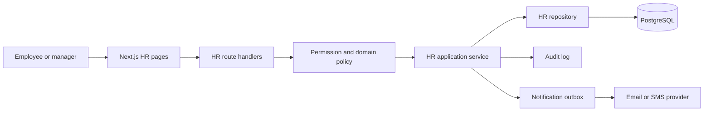

# HR System Development Recommendation

## Recommendation

Build the HR system as a secure, modular, database-backed application using the same foundation as this project:

- Next.js App Router for pages and route handlers
- React components for reusable screens and workflows
- TypeScript for application and domain types
- Prisma for data access and migrations
- PostgreSQL for production rather than SQLite
- HTTP-only cookie sessions with role-based access control
- Audit logs for sensitive HR changes
- Server Components for read-heavy pages and Client Components for interactive forms

The first release should be an **employee operations system**, not a full payroll platform. Start with the workflows the HR team uses every day, then add payroll and integrations after the employee data model and approval history are reliable.

## Product Scope

### MVP modules

1. **Employee directory**
   - Employee profile
   - Employee number
   - Department and job title
   - Manager
   - Employment status
   - Start date and end date
   - Contact and emergency details
   - Documents and profile photo

2. **Departments and positions**
   - Departments
   - Locations
   - Job titles
   - Reporting structure
   - Active and archived records

3. **Leave management**
   - Leave types
   - Leave balances
   - Leave requests
   - Manager approval or rejection
   - HR override
   - Holiday calendar
   - Leave history

4. **Attendance**
   - Daily attendance records
   - Check-in and check-out or imported timesheets
   - Absence and lateness status
   - Manager corrections with an audit trail

5. **Employee self-service**
   - View personal information
   - Submit leave requests
   - View leave balance and history
   - Download approved documents
   - Update selected contact details for HR approval

6. **HR dashboard and reports**
   - Headcount
   - New hires and exits
   - Leave usage
   - Attendance exceptions
   - Pending approvals
   - Exportable reports with access control

### Later modules

- Recruitment and applicant tracking
- Onboarding checklists
- Performance reviews and goals
- Training and certifications
- Expense claims
- Payroll integration
- Benefits administration
- Asset assignment
- Employee surveys
- Mobile application

## Roles and Permissions

Do not use one generic `ADMIN` role for the HR system. HR data needs narrower permissions than the current content dashboard.

Recommended roles:

| Role | Typical access |
| --- | --- |
| System administrator | Users, roles, configuration, integrations, technical support |
| HR administrator | All employee records, leave policies, documents, reports |
| HR officer | Employee records and operational workflows assigned to HR |
| Manager | Direct reports, approvals, team attendance, team reports |
| Employee | Own profile, own leave, own documents, own requests |
| Finance/payroll officer | Approved payroll inputs and controlled employee fields |
| Auditor | Read-only access to approved reports and audit history |

Use permissions in addition to roles when the organization grows. For example:

```text
employee:read:any
employee:read:self
employee:update:any
employee:update:self
leave:approve:team
leave:approve:any
attendance:correct:team
report:export:hr
payroll:read:finance
```

## Architecture Based on This Project

### Proposed layers

| Layer | HR responsibility | Suggested location |
| --- | --- | --- |
| Presentation | Dashboards, tables, forms, employee portal | `app/hr`, `components/hr` |
| Application | Leave approval, onboarding, attendance workflows | `lib/hr/services`, `app/api/hr` |
| Authorization | Role and permission checks | `lib/auth.ts`, `lib/permissions.ts`, middleware |
| Data access | HR queries and transactional operations | `lib/hr/repositories` |
| Domain model | Employee, leave, attendance, document rules | `lib/hr/domain` |
| Persistence | Tables, indexes, constraints, migrations | `prisma/schema.prisma` |
| Integrations | Email, payroll, identity, storage | `lib/integrations` |

Keep business rules out of page components. A page should load data and compose UI; a service should decide whether a leave request can be approved or whether an attendance correction is allowed.

## Design Patterns to Reuse

### 1. Layered architecture

Continue separating presentation, application, data access, and infrastructure concerns. This makes it possible to replace SQLite with PostgreSQL and add integrations without rewriting the UI.

### 2. Repository-style data access

Follow the existing `lib/data.ts` approach, but create HR-specific repositories for more complex queries:

```text
lib/hr/repositories/employee-repository.ts
lib/hr/repositories/leave-repository.ts
lib/hr/repositories/attendance-repository.ts
```

Repositories should handle filtering, pagination, sorting, and relationship loading. They should not contain UI concerns.

### 3. Service layer for workflows

Use application services for operations that affect multiple records:

```text
requestLeave()
approveLeave()
rejectLeave()
correctAttendance()
terminateEmployee()
completeOnboardingTask()
```

A leave approval service, for example, should verify the approver, check the employee balance, prevent overlapping requests, update the request state, and write an audit event in one controlled workflow.

### 4. State machine for approval workflows

Leave, onboarding, performance reviews, and employee changes should use explicit states rather than scattered boolean fields.

Example leave states:

```text
DRAFT -> SUBMITTED -> APPROVED -> TAKEN
                  |-> REJECTED
                  |-> CANCELLED
```

Every transition should define:

- Allowed current state
- Required actor permission
- Validation rules
- Timestamp and actor
- Notification behavior
- Audit event

### 5. Provider and context pattern

Use Context only for genuinely shared browser state, such as an employee portal session summary, notification count, or filter preferences. Keep server-owned HR data in server queries and API responses rather than copying the entire employee directory into client state.

### 6. Generic CRUD factory with HR safeguards

The existing CRUD factory can be reused for simple reference data such as departments, job titles, leave types, and holidays. Do not use generic CRUD handlers for sensitive workflows without additional domain validation.

A useful split is:

```text
Generic CRUD: departments, locations, leave types
Domain services: leave approval, termination, payroll export
```

### 7. Guard and policy pattern

Keep authentication and authorization separate:

- Authentication answers: who is signed in?
- Authorization answers: what can this person do to this record?

For every employee record, check both the permission and the scope. A manager may have `employee:read:team` but must not access employees outside their reporting structure.

### 8. Audit trail pattern

Audit every sensitive event, including:

- Employee creation and archival
- Changes to salary or employment status
- Changes to bank or tax details
- Document upload and deletion
- Leave approval or rejection
- Attendance correction
- Permission changes
- Report export

Store structured event data rather than only a sentence. Include actor, target, action, old value, new value, timestamp, IP address, and request correlation ID where appropriate.

### 9. Transactional workflow pattern

Use database transactions for operations that must succeed or fail together:

```text
Approve leave
  -> update leave request
  -> decrement or reserve balance
  -> create audit event
  -> create notification
```

External email or payroll calls should happen after the database transaction, with retryable integration records rather than making the user repeat the entire action.

### 10. Outbox and notification pattern

For reliable notifications, create a notification or outbox record inside the database transaction. A worker can later send email or SMS and mark the notification as sent or failed.

This avoids losing a notification when the database update succeeds but an email provider is unavailable.

## Recommended Data Model

A starting Prisma model set could include:

```text
User
Role
Permission
UserRole
Department
Location
Position
Employee
EmployeeContact
EmergencyContact
EmploymentRecord
LeaveType
LeaveBalance
LeaveRequest
Holiday
AttendanceRecord
AttendanceCorrection
Document
OnboardingTemplate
OnboardingTask
Notification
AuditLog
```

Important relationships:

```text
User -> Employee account
Employee -> Department
Employee -> Position
Employee -> Manager Employee
Employee -> LeaveBalance
Employee -> LeaveRequest
Employee -> AttendanceRecord
Employee -> Document
Employee -> OnboardingTask
```

Use immutable employment records for changes such as department transfers, promotions, and status changes. Updating a single current department field is not enough for HR reporting because it loses historical context.

## Employee Data Rules

HR data is more sensitive than website content. Define field-level access before building screens.

Examples:

| Data | Employee | Manager | HR | Finance |
| --- | --- | --- | --- | --- |
| Name and work email | Read | Team read | Full | Work use |
| Personal phone | Own update | Team limited | Full | Limited |
| Salary | No | No | Controlled | Controlled |
| Bank details | No | No | Restricted | Controlled |
| Leave history | Own | Team | Full | Optional |
| Medical information | Restricted | No | Restricted | No |
| Attendance | Own | Team | Full | Approved export |

Do not rely only on hiding fields in the UI. Enforce these rules in server-side queries and API handlers.

## Suggested Folder Structure

```text
app/
  hr/
    layout.tsx
    page.tsx
    employees/
    leave/
    attendance/
    reports/
    settings/
  api/
    hr/
      employees/
      leave/
      attendance/
      reports/

components/
  hr/
    EmployeeTable.tsx
    EmployeeForm.tsx
    LeaveRequestForm.tsx
    ApprovalPanel.tsx
    AttendanceTable.tsx
    ReportFilters.tsx

lib/
  hr/
    domain/
      leave-policy.ts
      employment-status.ts
    repositories/
      employee-repository.ts
      leave-repository.ts
    services/
      employee-service.ts
      leave-service.ts
      attendance-service.ts
    permissions.ts
    validation.ts
  notifications/
  integrations/

prisma/
  schema.prisma
  migrations/
```

## Key Workflows

### Leave request

1. Employee opens the leave form.
2. Server loads available leave types and balance.
3. Employee submits dates and reason.
4. Server validates date overlap, balance, holidays, and policy.
5. Request is stored as `SUBMITTED`.
6. Manager receives a notification.
7. Manager approves or rejects it.
8. The service updates the balance and records an audit event.
9. Employee receives the final status.

### Employee onboarding

1. HR creates the employee record.
2. The system creates an account invitation.
3. An onboarding template creates required tasks.
4. The employee uploads or completes assigned information.
5. HR verifies documents and marks tasks complete.
6. The system records completion and outstanding items.

### Employee termination

1. HR starts a termination workflow.
2. The system requires a reason, effective date, and authorized actor.
3. The employee is marked as pending termination rather than immediately deleted.
4. Access is revoked on the effective date.
5. Assets, leave, documents, and final payroll inputs are reviewed.
6. The employee record is archived, never physically deleted by default.

## Security and Compliance Baseline

Before using the system with real employee data, add:

- PostgreSQL with encrypted backups
- HTTPS everywhere
- Strong password policy and optional MFA
- HTTP-only, secure, same-site cookies
- CSRF protection where applicable
- Server-side authorization on every HR query
- Field-level protection for salary, tax, bank, and medical data
- Malware scanning for uploaded documents
- Private object storage for documents
- Signed, expiring download URLs
- Rate limiting on authentication and public endpoints
- Session revocation and password reset flows
- Audit logs that privileged users cannot casually alter
- Data retention and deletion policies
- Regular dependency updates and security testing
- Environment-specific secrets, never committed to the repository

The legal requirements depend on the countries where employees and the company operate. Obtain local legal and HR advice for privacy, employment, payroll, tax, and retention obligations before production use.

## Implementation Phases

### Phase 1: Foundation

- Move production persistence to PostgreSQL.
- Add HR route groups and navigation.
- Extend authentication with roles and permissions.
- Add employee, department, position, and location models.
- Add server-side validation and pagination.
- Add audit events for all HR mutations.

### Phase 2: Employee operations

- Build employee directory and profile pages.
- Add employment history.
- Add secure document storage.
- Add employee self-service profile view.
- Add search, filters, and exports with permission checks.

### Phase 3: Leave and attendance

- Implement leave policies and balances.
- Add request and approval state machines.
- Add attendance records and correction workflows.
- Add notifications and manager dashboards.

### Phase 4: Reporting and onboarding

- Add onboarding templates and tasks.
- Add headcount and turnover reports.
- Add leave and attendance reports.
- Add scheduled exports and controlled downloads.

### Phase 5: Integrations

- Email and SMS notifications
- Identity provider or company directory
- Payroll provider
- Calendar integration
- Biometric or time-clock import
- Accounting and finance exports

## Testing Strategy

Test the domain rules more heavily than the visual components:

- Unit tests for leave balance and date-overlap rules
- Unit tests for permission scopes
- Integration tests for approval transactions
- API tests for unauthorized access
- Tests that verify audit events are written
- Tests for duplicate submissions and idempotency
- End-to-end tests for employee, manager, and HR workflows
- Upload security tests for documents
- Report access tests for restricted fields

Important test cases include:

- A manager cannot approve leave for a non-team employee.
- An employee cannot read another employee's salary or documents.
- Two overlapping leave requests cannot both consume the same balance.
- A rejected request does not reduce the balance.
- A terminated employee cannot sign in after access is revoked.
- An attendance correction always records the actor and previous value.

## Recommended First Build

The strongest first milestone is:

> A secure employee directory with role-based access, employee self-service, leave requests, manager approvals, audit history, and a basic HR dashboard.

This is large enough to demonstrate meaningful business value and workflow design, but small enough to build and test before introducing payroll complexity. It also reuses the strongest patterns already present in this project instead of forcing every HR feature into the existing generic CMS screens.

## Architecture Flow



## Final Advice

Treat HR as a domain with protected workflows, not as another CRUD section in the admin dashboard. Reuse the existing visual language and infrastructure, but introduce HR-specific services, permission scopes, state transitions, transactional updates, and security controls from the beginning.
